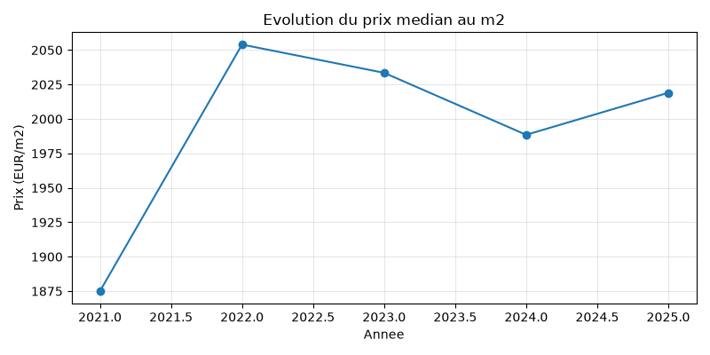
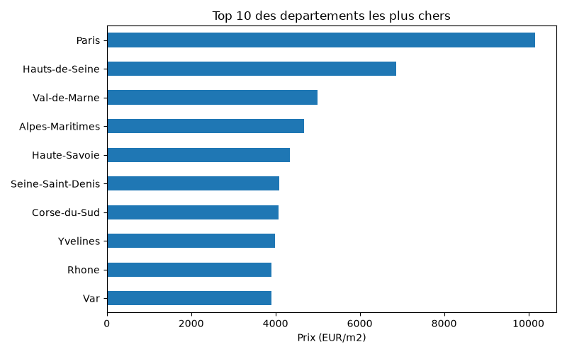
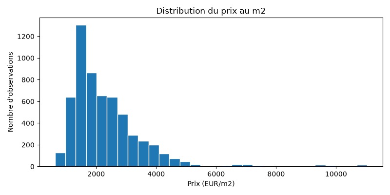

# Analyse des prix immobiliers en France (2021-2025)

Projet d'analyse de données réalisé avec Python à partir des statistiques DVF (Demandes de Valeurs Foncières).

## Objectif

Comprendre comment évoluent les prix de l'immobilier en France et identifier les départements les plus chers.

Questions étudiées :
- Quel est le prix médian au m² ?
- Quels départements sont les plus chers ?
- Comment les prix ont-ils évolué entre 2021 et 2025 ?

## Données

- **Source** : data.gouv.fr, statistiques DVF (Demandes de Valeurs Foncières)
- **Fichier** : `stats_dvf.csv` (3,65 millions de lignes, 17 colonnes, non inclus dans ce dépôt car trop volumineux : à télécharger sur data.gouv.fr)
- **Échelles du fichier** : section, commune, EPCI (intercommunalités), département, nation
- **Échelle retenue** : départements (5 820 observations mensuelles)
- **Période** : 2021 à 2025
- **Variable principale** : prix médian au m² (appartements et maisons)

## Outils

- Python 3
- Pandas (manipulation et nettoyage des données)
- Matplotlib (visualisation)

## Méthode

1. Chargement et exploration du fichier
2. Sélection d'une seule échelle géographique (les départements) pour comparer des zones comparables
3. Nettoyage : conversion des dates, suppression des valeurs manquantes, des prix impossibles et des doublons
4. Calcul des statistiques : prix médian, moyen, minimum et maximum
5. Classement des départements par prix moyen sur la période
6. Calcul de l'évolution du prix médian par année
7. Création de 3 graphiques

## Résultats

| Indicateur | Valeur |
|---|---|
| Prix médian au m² (départements, 2021-2025) | 2 000 € |
| Prix moyen au m² | 2 336 € |
| Évolution du prix médian 2021 → 2025 | +7,7 % |

### Prix médian par année

| Année | Prix médian (€/m²) |
|---|---|
| 2021 | 1 875 |
| 2022 | 2 054 |
| 2023 | 2 034 |
| 2024 | 1 988 |
| 2025 | 2 019 |

### Top 10 des départements les plus chers (prix moyen 2021-2025)

| Rang | Département | Prix (€/m²) |
|---|---|---|
| 1 | Paris | 10 156 |
| 2 | Hauts-de-Seine | 6 865 |
| 3 | Val-de-Marne | 4 993 |
| 4 | Alpes-Maritimes | 4 673 |
| 5 | Haute-Savoie | 4 348 |
| 6 | Seine-Saint-Denis | 4 094 |
| 7 | Corse-du-Sud | 4 066 |
| 8 | Yvelines | 3 986 |
| 9 | Rhône | 3 910 |
| 10 | Var | 3 898 |

### Les 10 départements les moins chers (prix moyen 2021-2025)

| Rang | Département | Prix (€/m²) |
|---|---|---|
| 1 | Creuse | 809 |
| 2 | Haute-Marne | 965 |
| 3 | Nièvre | 1 004 |
| 4 | Indre | 1 031 |
| 5 | Meuse | 1 036 |
| 6 | Haute-Saône | 1 144 |
| 7 | Ardennes | 1 186 |
| 8 | Allier | 1 187 |
| 9 | Cher | 1 199 |
| 10 | Aisne | 1 251 |

### Graphiques







## Conclusions

1. **Hausse modérée mais irrégulière** : le prix médian au m² a progressé de 7,7 % entre 2021 et 2025 (1 875 € à 2 019 €), avec un pic en 2022 (+9,5 %), un repli jusqu'en 2024 (-3,2 %), puis une reprise en 2025 (+1,6 %).
2. **Un marché très concentré** : Paris (10 156 €/m²) coûte environ 5 fois plus cher que le prix médian des départements (2 000 €/m²), et 5 des 10 départements les plus chers sont en Île-de-France.
3. **Moyenne supérieure à la médiane** : la moyenne (2 336 €) dépasse la médiane de 17 %, ce qui montre que quelques départements très chers tirent les prix vers le haut.
4. **Un écart territorial très fort** : le prix moyen de Paris (10 156 €/m²) est environ 12,5 fois supérieur à celui de la Creuse (809 €/m² sur 2021-2025), le département le moins cher. Les 10 départements les moins chers sont des territoires ruraux du centre et du nord-est (Creuse, Haute-Marne, Nièvre, Indre, Meuse...), tous sous 1 300 €/m².

## Limites

- Dans les petits départements peu actifs comme la Creuse, les prix médians varient d'un mois à l'autre (minimum de 624 €/m² en février 2021, contre 770 à 860 €/m² habituellement) : il vaut mieux comparer des moyennes sur plusieurs années que des mois isolés.
- Les prix sont en euros courants : l'inflation n'est pas prise en compte.
- La médiane est calculée sur les départements, sans pondération par le nombre de ventes.
- Les données sont agrégées : elles ne permettent pas d'analyser un bien en particulier (surface, étage, état).
- Les derniers mois de 2025 peuvent être incomplets

## Lancer le projet

1. Installer les bibliothèques :
   ```
   pip install pandas matplotlib
   ```
2. Placer `stats_dvf.csv` dans le même dossier que le script.
3. Lancer :
   ```
   py analyse_dvf.py
   ```
4. Les graphiques sont créés dans le dossier `graphiques/`.


## Auteur
N. Polina
